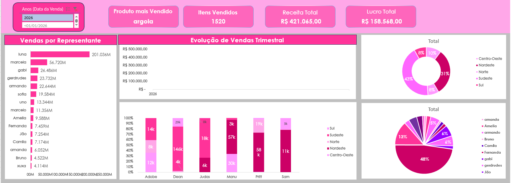

# Dashboard de Vendas no Excel

Projeto desenvolvido para praticar Excel utilizando dados fictícios de vendas.

A ideia foi treinar desde a organização dos dados até a criação de um dashboard, utilizando fórmulas, tabelas dinâmicas, gráficos e indicadores.

## Dashboard

## O que foi praticado

- Organização de dados
- Fórmulas do Excel
- Tabelas dinâmicas
- Gráficos
- Indicadores
- Criação e organização de dashboard

## Fórmulas utilizadas

| Fórmula | Utilização |
|---|---|
| **PROCV (VLOOKUP)** | Busca de informações nas tabelas |
| **TEXTO (TEXT)** | Tratamento e formatação de datas |
| **ANO (YEAR)** | Identificação do ano |
| **DATA (DATE)** | Criação e organização de datas |
| **Multiplicação (`*`)** | Cálculos de valores |
| **Subtração (`-`)** | Cálculos de diferenças |
| **Adição (`+`)** | Cálculos e criação de sequências |

## Sobre o dashboard

O dashboard reúne os principais resultados das vendas em uma visualização mais simples e fácil de acompanhar.

A identidade visual foi feita em tons de rosa porque **rosa é minha cor preferida** e eu quis trazer essa característica para o projeto.

## Dados

Todos os dados utilizados são **fictícios** e foram criados exclusivamente para praticar Excel.
